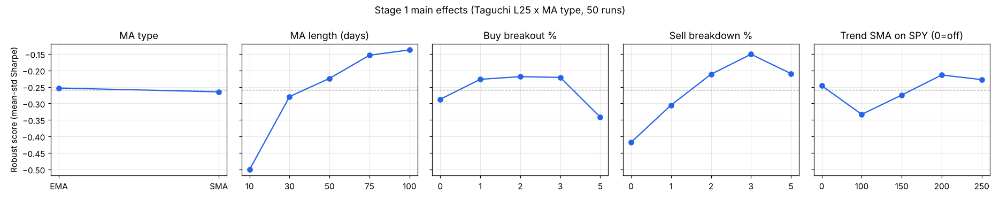
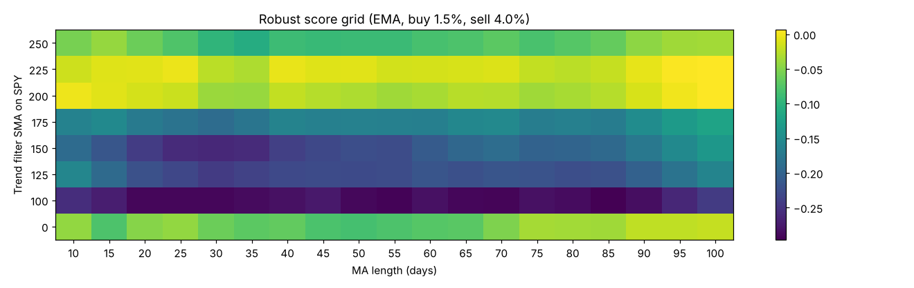
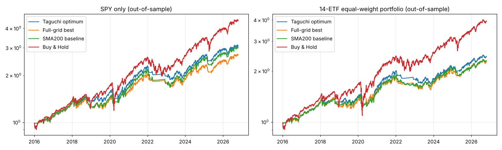

# 이동평균 돌파 전략 최적화 리포트 (다구치 실험계획법)

- 데이터: 미국 ETF 14종 수정주가(배당·분할 반영) 1998-12-22 ~ 2026-10-20
- 학습 구간(잡음 인자 3국면): 2000–2005, 2006–2010, 2011–2015
- 표본외 검증 구간: 2016 ~ 2026-10-20 (최적화에 미사용)
- 비용: 편도 0.1%, 현금 보유 시 단기국채 이자 수취, 신호 다음날 종가 체결

## 1. 장기추세 기준종목 선정 — '시장 전체를 가장 잘 대변하는 종목'

투자대상군 14종 동일가중 일간수익률과 각 지수 ETF의 상관관계(2000–2015):

| ticker | 상관계수 | 설명력 R² |
|---|---|---|
| SPY | 0.982 | 0.965 |
| DIA | 0.955 | 0.912 |
| MDY | 0.949 | 0.901 |
| IWM | 0.927 | 0.860 |
| QQQ | 0.814 | 0.663 |

→ 기준종목: **SPY** (투자대상군 전체 움직임을 가장 잘 설명)

## 2. 1단계 실험 — L25 직교배열 × 이평 종류(SMA/EMA) = 50회

인자와 수준: 이평 기간(일) [10, 30, 50, 75, 100]; 매수 돌파 % [0, 1, 2, 3, 5]; 매도 이탈 % [0, 1, 2, 3, 5]; 장기추세 SMA(0=없음) [0, 100, 150, 200, 250]; 이평 종류 [SMA, EMA]

반응값: 학습구간 3국면 × 14종목 = 42개 셀의 샤프지수 → **로버스트 점수 = 평균 − 표준편차** (다구치 SN비의 취지: 잡음(국면·종목)이 바뀌어도 성과가 흔들리지 않는 조건)
(50회 소요 0.5초)

### 분산분석(ANOVA) — 어떤 인자가 성과를 좌우하나

|  | dof | SS | F | p_value | contrib_% |
|---|---|---|---|---|---|
| 이평 종류 | 1.0000 | 0.0017 | 0.3736 | 0.5454 | 0.1012 |
| 이평 기간(일) | 4.0000 | 0.8575 | 48.0900 | 0.0000 | 52.0838 |
| 매수 돌파 % | 4.0000 | 0.1170 | 6.5590 | 0.0006 | 7.1037 |
| 매도 이탈 % | 4.0000 | 0.4385 | 24.5920 | 0.0000 | 26.6343 |
| 장기추세 SMA(0=없음) | 4.0000 | 0.0891 | 4.9977 | 0.0030 | 5.4127 |
| (error) | 32.0000 | 0.1427 |  |  | 8.6644 |

### 수준별 평균 로버스트 점수 (주효과)

- 이평 종류: EMA→-0.253, SMA→-0.265  ⇒ 최적 **EMA**
- 이평 기간(일): 10→-0.500, 30→-0.279, 50→-0.224, 75→-0.154, 100→-0.138  ⇒ 최적 **100**
- 매수 돌파 %: 0→-0.287, 1→-0.227, 2→-0.219, 3→-0.221, 5→-0.341  ⇒ 최적 **2**
- 매도 이탈 %: 0→-0.418, 1→-0.305, 2→-0.211, 3→-0.151, 5→-0.209  ⇒ 최적 **3**
- 장기추세 SMA(0=없음): 0→-0.246, 100→-0.333, 150→-0.274, 200→-0.214, 250→-0.228  ⇒ 최적 **200**

## 3. 2단계 실험 — 1단계 최적점 주변 정밀 탐색 (L25 = 25회, 이평 종류 EMA 고정)

인자와 수준: 이평 기간(일) [80, 85, 90, 95, 100]; 매수 돌파 % [1.0, 1.5, 2.0, 2.5, 3.0]; 매도 이탈 % [2.0, 2.5, 3.0, 3.5, 4.0]; 장기추세 SMA(0=없음) [150, 175, 200, 225, 250]

|  | dof | SS | F | p_value | contrib_% |
|---|---|---|---|---|---|
| 이평 기간(일) | 4.0000 | 0.0024 | 2.4324 | 0.1325 | 2.3899 |
| 매수 돌파 % | 4.0000 | 0.0015 | 1.5700 | 0.2718 | 1.5426 |
| 매도 이탈 % | 4.0000 | 0.0016 | 1.6388 | 0.2557 | 1.6102 |
| 장기추세 SMA(0=없음) | 4.0000 | 0.0922 | 94.1349 | 0.0000 | 92.4921 |
| (error) | 8.0000 | 0.0020 |  |  | 1.9651 |

- 이평 기간(일): 80→-0.107, 85→-0.091, 90→-0.086, 95→-0.085, 100→-0.078  ⇒ 최적 **100**
- 매수 돌파 %: 1.0→-0.087, 1.5→-0.077, 2.0→-0.091, 2.5→-0.089, 3.0→-0.102  ⇒ 최적 **1.5**
- 매도 이탈 %: 2.0→-0.101, 2.5→-0.095, 3.0→-0.083, 3.5→-0.089, 4.0→-0.079  ⇒ 최적 **4.0**
- 장기추세 SMA(0=없음): 150→-0.179, 175→-0.138, 200→-0.036, 225→-0.019, 250→-0.075  ⇒ 최적 **225**

## 4. 확인 실험 (다구치 최적조건을 실제로 돌려 예측과 비교)

- 최적조건: 이평 종류=EMA, 이평 기간(일)=100, 매수 돌파 %=1.5, 매도 이탈 %=4.0, 장기추세 SMA(0=없음)=225
- 가법모형 예측 로버스트 점수 0.015 vs 실측 0.006  (차이가 작으면 인자 간 교호작용이 작아 다구치 가정이 성립)
- 학습구간 평균 샤프 0.337, 평균 CAGR 5.10%, 평균 MDD -19.16%
- (비교) 같은 구간 매수 후 보유: 평균 샤프 0.362, 평균 CAGR 5.81%, 평균 MDD -40.73%

## 5. 검증 — 전수조사(Full grid)와 비교: 75회 실험으로 얼마나 최적에 가까웠나

- 전수조사 조합 수: **24,624회** vs 다구치 **75회** (약 328배 절약)
- 다구치 최적조건 순위: 24,624개 중 **321위** (상위 1.30%)
- 전수조사 1위: 이평 종류=SMA, 이평 기간(일)=15, 매수 돌파 %=1.5, 매도 이탈 %=5.0, 장기추세 SMA(0=없음)=200 → 로버스트 점수 0.051 (다구치 0.006)

전수조사 상위 10개 조합 (학습구간 기준):

| 순위 | ma_type | ma_len | buy_pct | sell_pct | trend_len | sn | sharpe | cagr | mdd |
|---|---|---|---|---|---|---|---|---|---|
| 1 | SMA | 15 | 1.500 | 5.000 | 200 | 0.051 | 0.351 | 0.052 | -0.197 |
| 2 | EMA | 35 | 2.500 | 5.000 | 225 | 0.042 | 0.332 | 0.049 | -0.183 |
| 3 | SMA | 15 | 1.500 | 5.000 | 225 | 0.040 | 0.349 | 0.052 | -0.193 |
| 4 | EMA | 35 | 0.000 | 5.000 | 200 | 0.040 | 0.341 | 0.052 | -0.200 |
| 5 | SMA | 20 | 1.500 | 5.000 | 225 | 0.038 | 0.350 | 0.052 | -0.188 |
| 6 | SMA | 20 | 1.000 | 5.000 | 200 | 0.037 | 0.339 | 0.050 | -0.201 |
| 7 | EMA | 80 | 1.500 | 5.000 | 0 | 0.037 | 0.389 | 0.063 | -0.257 |
| 8 | EMA | 95 | 0.000 | 5.000 | 0 | 0.035 | 0.388 | 0.064 | -0.260 |
| 9 | SMA | 20 | 1.500 | 5.000 | 200 | 0.034 | 0.347 | 0.051 | -0.194 |
| 10 | EMA | 40 | 0.500 | 5.000 | 225 | 0.034 | 0.347 | 0.053 | -0.193 |

- 과최적화 점검: 학습구간 로버스트 점수 vs 표본외 샤프 순위상관 ρ = 0.579 (p=0.0e+00). 양(+)이면 학습구간에서 좋던 조건이 미래에도 대체로 좋았다는 뜻

| 학습구간 성적 5분위 | sn | oos_sharpe | oos_cagr | oos_mdd |
|---|---|---|---|---|
| 하위20% | -0.457 | 0.178 | 0.038 | -0.214 |
| 20-40% | -0.290 | 0.287 | 0.053 | -0.244 |
| 40-60% | -0.208 | 0.311 | 0.057 | -0.252 |
| 60-80% | -0.138 | 0.329 | 0.060 | -0.257 |
| 상위20% | -0.050 | 0.386 | 0.069 | -0.252 |

## 6. 표본외 검증 2016–2026 (최적화에 쓰지 않은 미래 구간)

14종 각각에 전략을 적용한 평균, 그리고 14종 동일가중 포트폴리오 성과:

| 전략 | 종목평균 CAGR | 종목평균 샤프 | 종목평균 MDD | 포트폴리오 CAGR | 포트폴리오 샤프 | 포트폴리오 MDD |
|---|---|---|---|---|---|---|
| 다구치 최적 | 0.082 | 0.461 | -0.252 | 0.086 | 0.641 | -0.165 |
| 전수조사 1위 | 0.075 | 0.435 | -0.258 | 0.079 | 0.582 | -0.164 |
| 기본형 SMA200 단독(필터 없음) | 0.076 | 0.394 | -0.291 | 0.081 | 0.597 | -0.167 |
| 매수 후 보유(B&H) | 0.129 | 0.581 | -0.386 | 0.136 | 0.693 | -0.367 |

종목별 (다구치 최적 vs 매수 후 보유):

| 종목 | 다구치 최적 cagr | 다구치 최적 sharpe | 다구치 최적 mdd | 매수 후 보유(B&H) cagr | 매수 후 보유(B&H) sharpe | 매수 후 보유(B&H) mdd |
|---|---|---|---|---|---|---|
| SPY | 0.110 | 0.776 | -0.184 | 0.150 | 0.751 | -0.337 |
| QQQ | 0.140 | 0.767 | -0.230 | 0.197 | 0.819 | -0.351 |
| DIA | 0.083 | 0.563 | -0.232 | 0.130 | 0.664 | -0.367 |
| IWM | 0.087 | 0.469 | -0.279 | 0.101 | 0.438 | -0.411 |
| MDY | 0.072 | 0.413 | -0.251 | 0.107 | 0.487 | -0.422 |
| XLK | 0.166 | 0.836 | -0.237 | 0.235 | 0.893 | -0.336 |
| XLF | 0.079 | 0.448 | -0.289 | 0.124 | 0.541 | -0.428 |
| XLE | 0.076 | 0.379 | -0.387 | 0.122 | 0.464 | -0.668 |
| XLV | 0.058 | 0.358 | -0.205 | 0.107 | 0.559 | -0.284 |
| XLY | 0.064 | 0.348 | -0.279 | 0.118 | 0.517 | -0.397 |
| XLP | 0.034 | 0.160 | -0.185 | 0.081 | 0.451 | -0.245 |
| XLI | 0.088 | 0.523 | -0.189 | 0.132 | 0.612 | -0.423 |
| XLU | 0.035 | 0.161 | -0.296 | 0.097 | 0.466 | -0.360 |
| XLB | 0.049 | 0.252 | -0.284 | 0.105 | 0.478 | -0.372 |

