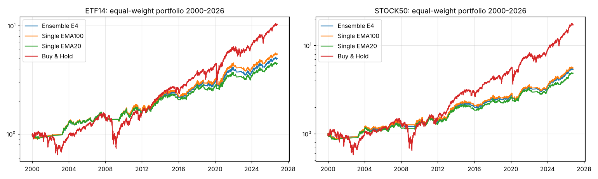
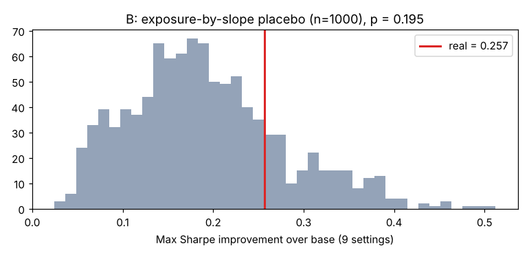

# 후속 검증 리포트 — 앙상블 · 기울기별 비중 조절 · 투자대상 확대

- 공통 매매 규칙: EMA, 이평선 +1.5% 돌파 매수 / −4% 이탈 매도, SPY>SMA225 장기추세 필터 (지난 다구치 최적)
- 다음날 종가 체결, 편도 0.1% 비용, 현금은 단기국채 이자. 학습 2000–2015 / 표본외 2016–2026
- 투자대상 ① ETF 14종  ② **대형주 50종목**: 1999년 말 S&P500 편입 종목 중 1999년 하루평균 거래대금 상위 50개. 당시 시점 정보로만 골랐고 이후 상장폐지·피인수 종목(Time Warner, Yahoo, Dell, EMC, 옛 DuPont, Xilinx 등) 포함 → 생존자 편향 없음

> **결론 요약** (이 상자는 실행 결과를 보고 사람이 덧붙인 해설)
> - **A. 앙상블**: 단일 EMA100보다 낫지 않았다 (ETF 전체 구간 샤프 차이 −0.028, p = 0.94 / 대형주 −0.007, p = 0.61). 최대낙폭은 1~2%p 정도 얕아졌다. 이평선 길이를 섞어도 위험조정수익은 사실상 같다.
> - **B. 기울기별 비중 조절**: 학습구간 최적값(약세 국면 100%, 완만 0%, 강세 25%)은 직관과 반대였다. 위약 검정 p = 0.195로 유의하지 않았고, 표본외에서는 샤프가 0.64에서 0.17로 **붕괴**했다(ETF·대형주 모두). 전형적인 과최적화다.
> - **C. 대형주 50종목 재검증**: 기울기별 이평 전환은 위약 검정 p = 0.72로 **역시 기각**됐다. ETF에서 고른 규칙을 종목에 그대로 쓰면 단일 이평과 비슷했다 (샤프 0.567 vs 0.545, 차이가 작아 의미 없음).
> - **일관되게 남는 사실**: 장기추세 필터(SPY>SMA225)가 있는 이평선 전략은 매수 후 보유와 샤프가 비슷하고, **최대낙폭은 약 1/3**이다 (대형주 −17% vs −57%). 대신 수익률은 낮다. 성과의 원천은 이평선 선택이 아니라 **하락장 회피 필터**다.

## A. 다중 이평선 앙상블

**규칙**: 이평선 [20, 50, 100, 200]일 각각의 매수/매도 신호를 따로 계산하고, '보유' 신호를 낸 이평선 비율만큼 투자 (4개 중 3개 보유 → 75%). 사전에 정한 **주 가설**: 앙상블 E4가 단일 EMA100(지난 최적)보다 샤프가 높다.

| ETF 14종 · 학습 2000–2015 | 종목평균 CAGR | 종목평균 샤프 | 종목평균 MDD | 포트 CAGR | 포트 샤프 | 포트 MDD | 평균 투자비중 | 연 매매회전 |
|---|---|---|---|---|---|---|---|---|
| 단일 EMA20 | 0.045 | 0.290 | -0.251 | 0.047 | 0.354 | -0.172 | 0.607 | 5.457 |
| 단일 EMA50 | 0.046 | 0.304 | -0.252 | 0.049 | 0.375 | -0.182 | 0.594 | 5.439 |
| 단일 EMA100 | 0.050 | 0.329 | -0.242 | 0.052 | 0.400 | -0.174 | 0.607 | 5.246 |
| 단일 EMA200 | 0.051 | 0.332 | -0.257 | 0.054 | 0.402 | -0.184 | 0.629 | 5.385 |
| 앙상블 E4 (20·50·100·200) | 0.048 | 0.322 | -0.236 | 0.050 | 0.387 | -0.170 | 0.609 | 5.382 |
| 앙상블 전체 22개(10~200) | 0.047 | 0.313 | -0.235 | 0.049 | 0.377 | -0.176 | 0.604 | 5.334 |
| 앙상블 E4, 장기필터 없음 | 0.049 | 0.292 | -0.330 | 0.053 | 0.359 | -0.228 | 0.773 | 3.077 |
| 매수 후 보유 | 0.053 | 0.283 | -0.596 | 0.062 | 0.319 | -0.531 | 1.000 | 0.000 |

| ETF 14종 · 표본외 2016–2026 | 종목평균 CAGR | 종목평균 샤프 | 종목평균 MDD | 포트 CAGR | 포트 샤프 | 포트 MDD | 평균 투자비중 | 연 매매회전 |
|---|---|---|---|---|---|---|---|---|
| 단일 EMA20 | 0.070 | 0.403 | -0.250 | 0.074 | 0.553 | -0.151 | 0.755 | 4.681 |
| 단일 EMA50 | 0.076 | 0.440 | -0.242 | 0.080 | 0.606 | -0.131 | 0.744 | 4.197 |
| 단일 EMA100 | 0.082 | 0.461 | -0.252 | 0.086 | 0.641 | -0.165 | 0.756 | 3.573 |
| 단일 EMA200 | 0.073 | 0.393 | -0.282 | 0.077 | 0.551 | -0.201 | 0.775 | 3.752 |
| 앙상블 E4 (20·50·100·200) | 0.075 | 0.436 | -0.242 | 0.080 | 0.595 | -0.160 | 0.757 | 4.051 |
| 앙상블 전체 22개(10~200) | 0.076 | 0.444 | -0.237 | 0.081 | 0.606 | -0.152 | 0.753 | 4.062 |
| 앙상블 E4, 장기필터 없음 | 0.084 | 0.469 | -0.293 | 0.089 | 0.639 | -0.194 | 0.831 | 2.819 |
| 매수 후 보유 | 0.129 | 0.581 | -0.386 | 0.136 | 0.693 | -0.367 | 1.000 | 0.000 |

| ETF 14종 · 전체 2000–2026 | 종목평균 CAGR | 종목평균 샤프 | 종목평균 MDD | 포트 CAGR | 포트 샤프 | 포트 MDD | 평균 투자비중 | 연 매매회전 |
|---|---|---|---|---|---|---|---|---|
| 단일 EMA20 | 0.054 | 0.338 | -0.284 | 0.058 | 0.435 | -0.172 | 0.667 | 5.144 |
| 단일 EMA50 | 0.058 | 0.362 | -0.276 | 0.061 | 0.471 | -0.182 | 0.654 | 4.938 |
| 단일 EMA100 | 0.062 | 0.385 | -0.284 | 0.066 | 0.500 | -0.174 | 0.667 | 4.572 |
| 단일 EMA200 | 0.060 | 0.357 | -0.305 | 0.063 | 0.463 | -0.201 | 0.688 | 4.727 |
| 앙상블 E4 (20·50·100·200) | 0.059 | 0.370 | -0.267 | 0.062 | 0.472 | -0.170 | 0.669 | 4.845 |
| 앙상블 전체 22개(10~200) | 0.059 | 0.369 | -0.265 | 0.062 | 0.471 | -0.176 | 0.664 | 4.821 |
| 앙상블 E4, 장기필터 없음 | 0.063 | 0.363 | -0.352 | 0.067 | 0.467 | -0.228 | 0.796 | 2.973 |
| 매수 후 보유 | 0.083 | 0.392 | -0.606 | 0.091 | 0.457 | -0.531 | 1.000 | 0.000 |

| 대형주 50종목(1999 기준) · 학습 2000–2015 | 종목평균 CAGR | 종목평균 샤프 | 종목평균 MDD | 포트 CAGR | 포트 샤프 | 포트 MDD | 평균 투자비중 | 연 매매회전 |
|---|---|---|---|---|---|---|---|---|
| 단일 EMA20 | 0.024 | 0.122 | -0.467 | 0.040 | 0.289 | -0.167 | 0.536 | 7.261 |
| 단일 EMA50 | 0.027 | 0.136 | -0.452 | 0.043 | 0.326 | -0.151 | 0.507 | 6.546 |
| 단일 EMA100 | 0.032 | 0.162 | -0.437 | 0.047 | 0.368 | -0.173 | 0.515 | 5.721 |
| 단일 EMA200 | 0.033 | 0.173 | -0.432 | 0.048 | 0.372 | -0.169 | 0.528 | 5.450 |
| 앙상블 E4 (20·50·100·200) | 0.031 | 0.155 | -0.420 | 0.045 | 0.343 | -0.161 | 0.522 | 6.244 |
| 앙상블 전체 22개(10~200) | 0.030 | 0.151 | -0.425 | 0.044 | 0.339 | -0.162 | 0.519 | 6.341 |
| 앙상블 E4, 장기필터 없음 | 0.016 | 0.105 | -0.593 | 0.037 | 0.227 | -0.396 | 0.667 | 4.979 |
| 매수 후 보유 | 0.013 | 0.215 | -0.757 | 0.071 | 0.339 | -0.569 | 1.000 | 0.000 |

| 대형주 50종목(1999 기준) · 표본외 2016–2026 | 종목평균 CAGR | 종목평균 샤프 | 종목평균 MDD | 포트 CAGR | 포트 샤프 | 포트 MDD | 평균 투자비중 | 연 매매회전 |
|---|---|---|---|---|---|---|---|---|
| 단일 EMA20 | 0.072 | 0.392 | -0.373 | 0.093 | 0.786 | -0.150 | 0.649 | 7.120 |
| 단일 EMA50 | 0.073 | 0.382 | -0.357 | 0.095 | 0.807 | -0.129 | 0.627 | 6.013 |
| 단일 EMA100 | 0.073 | 0.376 | -0.368 | 0.095 | 0.798 | -0.165 | 0.633 | 5.144 |
| 단일 EMA200 | 0.076 | 0.392 | -0.360 | 0.098 | 0.827 | -0.161 | 0.646 | 4.647 |
| 앙상블 E4 (20·50·100·200) | 0.075 | 0.397 | -0.340 | 0.095 | 0.818 | -0.143 | 0.639 | 5.731 |
| 앙상블 전체 22개(10~200) | 0.075 | 0.393 | -0.345 | 0.095 | 0.814 | -0.141 | 0.637 | 5.879 |
| 앙상블 E4, 장기필터 없음 | 0.085 | 0.419 | -0.358 | 0.107 | 0.857 | -0.167 | 0.714 | 4.472 |
| 매수 후 보유 | 0.135 | 0.557 | -0.445 | 0.177 | 0.873 | -0.362 | 1.000 | 0.000 |

| 대형주 50종목(1999 기준) · 전체 2000–2026 | 종목평균 CAGR | 종목평균 샤프 | 종목평균 MDD | 포트 CAGR | 포트 샤프 | 포트 MDD | 평균 투자비중 | 연 매매회전 |
|---|---|---|---|---|---|---|---|---|
| 단일 EMA20 | 0.039 | 0.203 | -0.524 | 0.061 | 0.488 | -0.167 | 0.578 | 7.209 |
| 단일 EMA50 | 0.042 | 0.210 | -0.519 | 0.063 | 0.520 | -0.151 | 0.552 | 6.349 |
| 단일 EMA100 | 0.045 | 0.223 | -0.508 | 0.066 | 0.539 | -0.173 | 0.558 | 5.507 |
| 단일 EMA200 | 0.046 | 0.231 | -0.491 | 0.068 | 0.553 | -0.169 | 0.572 | 5.153 |
| 앙상블 E4 (20·50·100·200) | 0.045 | 0.226 | -0.483 | 0.065 | 0.532 | -0.161 | 0.565 | 6.054 |
| 앙상블 전체 22개(10~200) | 0.045 | 0.223 | -0.490 | 0.064 | 0.529 | -0.162 | 0.562 | 6.170 |
| 앙상블 E4, 장기필터 없음 | 0.038 | 0.193 | -0.616 | 0.064 | 0.459 | -0.396 | 0.685 | 4.792 |
| 매수 후 보유 | 0.052 | 0.298 | -0.770 | 0.112 | 0.521 | -0.569 | 1.000 | 0.000 |

### 통계 검정 — 앙상블 E4 vs 단일 EMA100 (포트폴리오 샤프 차이, 63일 블록 부트스트랩 2,000회)

| 투자대상·구간 | 샤프 차이 | 90% 구간 | p값(단측) | 종목별 승 | 부호검정 p |
|---|---|---|---|---|---|
| ETF 14종 · 학습 | -0.013 | -0.047 ~ +0.015 | 0.794 | 5/14 | 0.910 |
| ETF 14종 · 표본외 | -0.047 | -0.103 ~ +0.006 | 0.929 | 5/14 | 0.910 |
| ETF 14종 · 전체 | -0.028 | -0.056 ~ +0.002 | 0.940 | 3/14 | 0.994 |
| 대형주 50종목(1999 기준) · 학습 | -0.025 | -0.059 ~ +0.021 | 0.771 | 19/50 | 0.968 |
| 대형주 50종목(1999 기준) · 표본외 | 0.020 | -0.044 ~ +0.069 | 0.351 | 33/47 | 0.004 |
| 대형주 50종목(1999 기준) · 전체 | -0.007 | -0.041 ~ +0.027 | 0.605 | 26/50 | 0.444 |

## B. 기울기 국면별 보유 비중 조절 — 기울기 정보가 낙폭 방어에 쓸모 있는가

**규칙**: 기본 신호(단일 EMA100 + SMA225 필터)가 '보유'일 때, SPY 200일선 기울기 국면에 따라 보유 비중을 [0.0, 0.25, 0.5, 0.75, 1.0] 중에서 국면별로 다르게 둔다(최대 비중 = 1로 정규화). 설정 9개(기울기 기간 [20, 60, 120] × 국면구분 Q3/Z2/Z3).

비중을 줄이면 낙폭은 당연히 줄어든다. 그래서 **같은 평균 비중을 항상 일정하게 유지하는 전략**과 비교한다. 샤프는 일정 비중으로는 바뀌지 않으므로, 샤프 개선 = 순수하게 '국면 판단'의 효과다.

ETF 14종, 학습구간 2000–2015 전수조사:

| 기울기기간 | 국면구분 | 국면별 비중(약→강) | 최적 샤프 | 기본 샤프 | Δ샤프 |
|---|---|---|---|---|---|
| 20 | Q3 | 1.00 / 0.75 / 0.75 | 0.402 | 0.400 | 0.002 |
| 20 | Z2 | 1.00 / 0.50 | 0.421 | 0.400 | 0.021 |
| 20 | Z3 | 1.00 / 0.50 / 0.50 | 0.421 | 0.400 | 0.021 |
| 60 | Q3 | 1.00 / 0.00 / 0.25 | 0.564 | 0.400 | 0.164 |
| 60 | Z2 | 1.00 / 0.25 | 0.551 | 0.400 | 0.151 |
| 60 | Z3 | 1.00 / 0.00 / 0.25 | 0.592 | 0.400 | 0.192 |
| 120 | Q3 | 1.00 / 0.25 / 0.50 | 0.479 | 0.400 | 0.079 |
| 120 | Z2 | 1.00 / 0.25 | 0.596 | 0.400 | 0.196 |
| 120 | Z3 | 1.00 / 0.00 / 0.25 | 0.657 | 0.400 | 0.257 |

- **위약 검정 1000회** (국면 라벨 무작위 이동, 9개 설정 중 최댓값 비교): 실제 최대 Δ샤프 0.257, 위약 평균 0.191, 위약 95% 0.354 → **p = 0.195**

최고 설정: 기울기 120일, Z3, 국면별 비중 (1.0, 0.0, 0.25). 이 설정을 고정한 채 **표본외 구간**과 **대형주 50종목**에 그대로 적용:

| 투자대상·구간 | 기본 샤프 | 국면비중 샤프 | 샤프차 p(부트) | 기본 MDD | 국면비중 MDD | 일정비중 MDD | 국면비중 CAGR | 일정비중 CAGR |
|---|---|---|---|---|---|---|---|---|
| ETF 14종 · 학습 | 0.400 | 0.647 | 0.166 | -0.174 | -0.063 | -0.031 | 0.043 | 0.025 |
| ETF 14종 · 표본외 | 0.641 | 0.174 | 0.994 | -0.165 | -0.088 | -0.035 | 0.028 | 0.038 |
| ETF 14종 · 전체 | 0.500 | 0.470 | 0.620 | -0.174 | -0.088 | -0.034 | 0.037 | 0.030 |
| 대형주 50종목(1999 기준) · 학습 | 0.368 | 0.553 | 0.246 | -0.173 | -0.059 | -0.031 | 0.039 | 0.025 |
| 대형주 50종목(1999 기준) · 표본외 | 0.798 | 0.227 | 0.998 | -0.165 | -0.081 | -0.040 | 0.029 | 0.040 |
| 대형주 50종목(1999 기준) · 전체 | 0.539 | 0.438 | 0.775 | -0.173 | -0.081 | -0.039 | 0.035 | 0.031 |

※ '일정비중' = 국면비중 전략과 평균 투자비중이 같도록 항상 고정 비율만 보유. 국면비중의 MDD·CAGR이 일정비중보다 좋아야 기울기 판단이 가치가 있다.

## C. 대형주 50종목에서 '기울기별 이평선 전환' 가설 재검증

ETF에서 기각된 가설을 독립된 표본(개별 종목)에서 다시 시험: ① ETF에서 고른 최적 규칙(SMA225 필터, 60일 기울기, 하락/완만/가파른 국면, 이평 10/25/120)을 그대로 적용  ② 종목 데이터로 18개 설정 전수조사 + 위약 검정.

대형주 50종목, 학습구간 2000–2015 전수조사 (점수 = 3시기 × 50종목 = 150셀 샤프의 평균 − 표준편차):

| 순위 | 필터 | 기울기기간 | 국면구분 | 국면별 이평 | 전환 점수 | 단일 최적 | 단일 점수 | Δ |
|---|---|---|---|---|---|---|---|---|
| 1 | SMA225 | 60 | Q3 | 20 / 65 / 10 | -0.212 | 10 | -0.245 | 0.032 |
| 2 | SMA225 | 120 | Q3 | 10 / 65 / 200 | -0.212 | 10 | -0.245 | 0.032 |
| 3 | SMA225 | 120 | Z3 | 10 / 65 / 200 | -0.217 | 10 | -0.245 | 0.028 |
| 4 | SMA225 | 60 | Z3 | 65 / 65 / 200 | -0.217 | 10 | -0.245 | 0.027 |
| 5 | SMA225 | 20 | Q3 | 25 / 65 / 10 | -0.221 | 10 | -0.245 | 0.023 |
| 6 | SMA225 | 20 | Z3 | 10 / 65 / 100 | -0.229 | 10 | -0.245 | 0.016 |
| 7 | 없음 | 120 | Z3 | 30 / 150 / 10 | -0.233 | 30 | -0.292 | 0.059 |
| 8 | SMA225 | 120 | Z2 | 10 / 200 | -0.238 | 10 | -0.245 | 0.006 |
| 9 | 없음 | 120 | Q3 | 30 / 150 / 10 | -0.239 | 30 | -0.292 | 0.052 |
| 10 | SMA225 | 60 | Z2 | 65 / 10 | -0.241 | 10 | -0.245 | 0.003 |
| 11 | SMA225 | 20 | Z2 | 10 / 75 | -0.243 | 10 | -0.245 | 0.002 |
| 12 | 없음 | 60 | Q3 | 30 / 150 / 120 | -0.246 | 30 | -0.292 | 0.046 |
| 13 | 없음 | 60 | Z3 | 30 / 45 / 200 | -0.251 | 30 | -0.292 | 0.041 |
| 14 | 없음 | 120 | Z2 | 30 / 150 | -0.253 | 30 | -0.292 | 0.038 |
| 15 | 없음 | 20 | Q3 | 10 / 150 / 200 | -0.256 | 30 | -0.292 | 0.036 |
| 16 | 없음 | 20 | Z3 | 35 / 20 / 120 | -0.257 | 30 | -0.292 | 0.035 |
| 17 | 없음 | 60 | Z2 | 30 / 150 | -0.257 | 30 | -0.292 | 0.034 |
| 18 | 없음 | 20 | Z2 | 30 / 150 | -0.265 | 30 | -0.292 | 0.026 |

- **위약 검정 200회**: 실제 최대 Δ 0.059, 위약 평균 0.071, 위약 95% 0.101 → **p = 0.720**

| 대형주 50종목 · 전체 2000–2026 | 종목평균 CAGR | 종목평균 샤프 | 종목평균 MDD | 포트 CAGR | 포트 샤프 | 포트 MDD | 평균 투자비중 | 연 매매회전 |
|---|---|---|---|---|---|---|---|---|
| ETF 최적 전환규칙(10/25/120) | 0.048 | 0.231 | -0.524 | 0.070 | 0.567 | -0.175 | 0.576 | 6.092 |
| 단일 EMA120 | 0.046 | 0.223 | -0.507 | 0.067 | 0.545 | -0.169 | 0.561 | 5.369 |
| 단일 EMA100(다구치) | 0.045 | 0.223 | -0.508 | 0.066 | 0.539 | -0.173 | 0.558 | 5.507 |
| 앙상블 E4 | 0.045 | 0.226 | -0.483 | 0.065 | 0.532 | -0.161 | 0.565 | 6.054 |
| 매수 후 보유 | 0.052 | 0.298 | -0.770 | 0.112 | 0.521 | -0.569 | 1.000 | 0.000 |

| 대형주 50종목 · 표본외 2016–2026 | 종목평균 CAGR | 종목평균 샤프 | 종목평균 MDD | 포트 CAGR | 포트 샤프 | 포트 MDD | 평균 투자비중 | 연 매매회전 |
|---|---|---|---|---|---|---|---|---|
| ETF 최적 전환규칙(10/25/120) | 0.075 | 0.381 | -0.363 | 0.099 | 0.820 | -0.150 | 0.646 | 5.801 |
| 단일 EMA120 | 0.074 | 0.373 | -0.368 | 0.096 | 0.808 | -0.169 | 0.635 | 5.018 |
| 단일 EMA100(다구치) | 0.073 | 0.376 | -0.368 | 0.095 | 0.798 | -0.165 | 0.633 | 5.144 |
| 앙상블 E4 | 0.075 | 0.397 | -0.340 | 0.095 | 0.818 | -0.143 | 0.639 | 5.731 |
| 매수 후 보유 | 0.135 | 0.557 | -0.445 | 0.177 | 0.873 | -0.362 | 1.000 | 0.000 |

