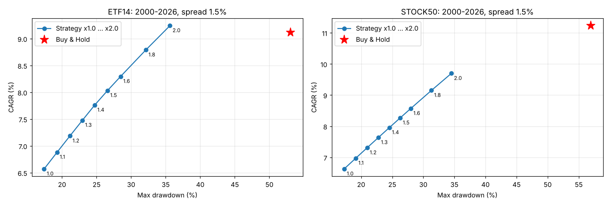

# 레버리지 검증 리포트 — 낙폭이 줄어든 만큼 비중을 키우면?

- 기본 규칙: EMA100 +1.5% 돌파 매수 / −4% 이탈 매도, SPY>SMA225 장기추세 필터 (다구치 최적)
- 보유 신호일 때 종목당 비중 m배 (예: 1.3 = 자기자본의 130%). 차입분 이자 = 단기국채 금리 + 가산금리. 매매비용 편도 0.1% × m
- 동일가중 포트폴리오 기준. 학습 2000–2015 / 표본외 2016–2026

> **결론 요약** (이 상자는 실행 결과를 보고 사람이 덧붙인 해설)
> - 비중을 키우면 수익률과 낙폭이 거의 같은 비율로 함께 커진다. 샤프는 레버리지 이자 때문에 조금씩 낮아진다 (ETF ×1.0 0.50 → ×2.0 0.45).
> - **변동성을 그냥 보유와 같게 맞춘 경우**(ETF ×1.9, 대형주 ×2.3) 연수익률은 사실상 같았다 (차이 −0.1%p / −0.8%p, p ≈ 0.5). **최대낙폭은 ETF −34% vs −53%, 대형주 −39% vs −57%**로 크게 얕아졌다.
> - 학습구간에서 정한 배율(MDD −30% 이내 → ×1.6)을 표본외 2016–2026에 적용하면, 그냥 보유보다 수익률은 낮았다 (ETF 11.3% vs 13.6%, 대형주 13.0% vs 17.7%). 최대낙폭은 더 얕았다 (−29% vs −37%, −26% vs −36%).
> - 판단: 레버리지로 수익률을 '그냥 보유 수준'까지 되찾는 것은 가능하지만, **넘어서지는 못한다**. 얻는 것은 같은 수익에 더 얕은 폭락이다. 강세장이 길었던 2016년 이후에는 그냥 보유가 더 나았다. 차입 비용이 연 3%면 이점이 더 줄어든다.

## ETF 14종

| 전체 2000–2026 (가산금리 1.5%) | CAGR | 변동성 | 샤프 | MDD | 최악의 해 | 칼마(CAGR/|MDD|) |
|---|---|---|---|---|---|---|
| 전략 ×1.0 | 0.066 | 0.099 | 0.500 | -0.174 | -0.104 | 0.377 |
| 전략 ×1.1 | 0.069 | 0.109 | 0.491 | -0.193 | -0.115 | 0.357 |
| 전략 ×1.2 | 0.072 | 0.119 | 0.483 | -0.211 | -0.127 | 0.340 |
| 전략 ×1.3 | 0.075 | 0.129 | 0.477 | -0.229 | -0.139 | 0.326 |
| 전략 ×1.4 | 0.078 | 0.139 | 0.471 | -0.247 | -0.150 | 0.314 |
| 전략 ×1.5 | 0.080 | 0.149 | 0.466 | -0.266 | -0.161 | 0.302 |
| 전략 ×1.6 | 0.083 | 0.159 | 0.462 | -0.285 | -0.172 | 0.291 |
| 전략 ×1.8 | 0.088 | 0.178 | 0.455 | -0.321 | -0.194 | 0.274 |
| 전략 ×2.0 | 0.092 | 0.198 | 0.450 | -0.356 | -0.216 | 0.260 |
| 그냥 보유 ×1.0 | 0.091 | 0.188 | 0.457 | -0.531 | -0.348 | 0.172 |

| 학습 2000–2015 (가산금리 1.5%) | CAGR | 변동성 | 샤프 | MDD | 최악의 해 | 칼마(CAGR/|MDD|) |
|---|---|---|---|---|---|---|
| 전략 ×1.0 | 0.052 | 0.097 | 0.400 | -0.174 | -0.080 | 0.300 |
| 전략 ×1.1 | 0.054 | 0.107 | 0.391 | -0.193 | -0.089 | 0.282 |
| 전략 ×1.2 | 0.056 | 0.117 | 0.384 | -0.211 | -0.098 | 0.266 |
| 전략 ×1.3 | 0.058 | 0.126 | 0.378 | -0.229 | -0.107 | 0.254 |
| 전략 ×1.4 | 0.060 | 0.136 | 0.373 | -0.247 | -0.116 | 0.243 |
| 전략 ×1.5 | 0.062 | 0.146 | 0.369 | -0.265 | -0.127 | 0.233 |
| 전략 ×1.6 | 0.063 | 0.156 | 0.365 | -0.282 | -0.139 | 0.225 |
| 전략 ×1.8 | 0.066 | 0.175 | 0.359 | -0.315 | -0.164 | 0.210 |
| 전략 ×2.0 | 0.069 | 0.194 | 0.353 | -0.347 | -0.189 | 0.198 |
| 그냥 보유 ×1.0 | 0.062 | 0.197 | 0.319 | -0.531 | -0.348 | 0.117 |

| 표본외 2016–2026 (가산금리 1.5%) | CAGR | 변동성 | 샤프 | MDD | 최악의 해 | 칼마(CAGR/|MDD|) |
|---|---|---|---|---|---|---|
| 전략 ×1.0 | 0.086 | 0.102 | 0.641 | -0.165 | -0.104 | 0.522 |
| 전략 ×1.1 | 0.091 | 0.112 | 0.631 | -0.186 | -0.115 | 0.488 |
| 전략 ×1.2 | 0.095 | 0.122 | 0.623 | -0.207 | -0.127 | 0.461 |
| 전략 ×1.3 | 0.100 | 0.132 | 0.616 | -0.227 | -0.139 | 0.440 |
| 전략 ×1.4 | 0.104 | 0.143 | 0.610 | -0.247 | -0.150 | 0.423 |
| 전략 ×1.5 | 0.109 | 0.153 | 0.605 | -0.266 | -0.161 | 0.408 |
| 전략 ×1.6 | 0.113 | 0.163 | 0.600 | -0.285 | -0.172 | 0.396 |
| 전략 ×1.8 | 0.121 | 0.183 | 0.592 | -0.321 | -0.194 | 0.376 |
| 전략 ×2.0 | 0.128 | 0.204 | 0.586 | -0.356 | -0.216 | 0.361 |
| 그냥 보유 ×1.0 | 0.136 | 0.173 | 0.693 | -0.367 | -0.101 | 0.371 |

## 대형주 50종목

| 전체 2000–2026 (가산금리 1.5%) | CAGR | 변동성 | 샤프 | MDD | 최악의 해 | 칼마(CAGR/|MDD|) |
|---|---|---|---|---|---|---|
| 전략 ×1.0 | 0.066 | 0.092 | 0.539 | -0.173 | -0.115 | 0.384 |
| 전략 ×1.1 | 0.070 | 0.101 | 0.531 | -0.191 | -0.132 | 0.365 |
| 전략 ×1.2 | 0.073 | 0.110 | 0.524 | -0.210 | -0.149 | 0.349 |
| 전략 ×1.3 | 0.076 | 0.119 | 0.518 | -0.228 | -0.166 | 0.335 |
| 전략 ×1.4 | 0.080 | 0.128 | 0.513 | -0.245 | -0.183 | 0.324 |
| 전략 ×1.5 | 0.083 | 0.137 | 0.509 | -0.263 | -0.199 | 0.315 |
| 전략 ×1.6 | 0.086 | 0.146 | 0.505 | -0.280 | -0.216 | 0.306 |
| 전략 ×1.8 | 0.092 | 0.165 | 0.499 | -0.313 | -0.248 | 0.292 |
| 전략 ×2.0 | 0.097 | 0.183 | 0.494 | -0.345 | -0.280 | 0.281 |
| 그냥 보유 ×1.0 | 0.112 | 0.210 | 0.521 | -0.569 | -0.363 | 0.197 |

| 학습 2000–2015 (가산금리 1.5%) | CAGR | 변동성 | 샤프 | MDD | 최악의 해 | 칼마(CAGR/|MDD|) |
|---|---|---|---|---|---|---|
| 전략 ×1.0 | 0.047 | 0.092 | 0.368 | -0.173 | -0.115 | 0.275 |
| 전략 ×1.1 | 0.049 | 0.101 | 0.360 | -0.191 | -0.132 | 0.257 |
| 전략 ×1.2 | 0.051 | 0.110 | 0.354 | -0.210 | -0.149 | 0.243 |
| 전략 ×1.3 | 0.053 | 0.120 | 0.348 | -0.228 | -0.166 | 0.231 |
| 전략 ×1.4 | 0.054 | 0.129 | 0.344 | -0.245 | -0.183 | 0.221 |
| 전략 ×1.5 | 0.056 | 0.138 | 0.340 | -0.263 | -0.199 | 0.212 |
| 전략 ×1.6 | 0.057 | 0.147 | 0.336 | -0.280 | -0.216 | 0.204 |
| 전략 ×1.8 | 0.059 | 0.166 | 0.331 | -0.313 | -0.248 | 0.190 |
| 전략 ×2.0 | 0.062 | 0.184 | 0.326 | -0.345 | -0.280 | 0.178 |
| 그냥 보유 ×1.0 | 0.071 | 0.229 | 0.339 | -0.569 | -0.363 | 0.124 |

| 표본외 2016–2026 (가산금리 1.5%) | CAGR | 변동성 | 샤프 | MDD | 최악의 해 | 칼마(CAGR/|MDD|) |
|---|---|---|---|---|---|---|
| 전략 ×1.0 | 0.095 | 0.091 | 0.798 | -0.165 | -0.076 | 0.574 |
| 전략 ×1.1 | 0.101 | 0.100 | 0.788 | -0.181 | -0.086 | 0.558 |
| 전략 ×1.2 | 0.107 | 0.109 | 0.781 | -0.196 | -0.095 | 0.545 |
| 전략 ×1.3 | 0.113 | 0.118 | 0.774 | -0.211 | -0.105 | 0.533 |
| 전략 ×1.4 | 0.118 | 0.127 | 0.768 | -0.226 | -0.114 | 0.524 |
| 전략 ×1.5 | 0.124 | 0.136 | 0.763 | -0.241 | -0.123 | 0.516 |
| 전략 ×1.6 | 0.130 | 0.145 | 0.759 | -0.255 | -0.132 | 0.509 |
| 전략 ×1.8 | 0.141 | 0.163 | 0.752 | -0.283 | -0.150 | 0.497 |
| 전략 ×2.0 | 0.152 | 0.182 | 0.746 | -0.311 | -0.167 | 0.488 |
| 그냥 보유 ×1.0 | 0.177 | 0.180 | 0.873 | -0.362 | -0.092 | 0.489 |

## 학습구간에서 레버리지를 정하고 표본외에서 확인

사전 규칙: **학습구간(2000–2015) 포트폴리오 MDD가 −30%를 넘지 않는 최대 배율** (그냥 보유는 −53~−57%). 이 배율을 고정해서 표본외 2016–2026에 적용한다.

| 투자대상·구간 | 선택 배율 | 전략 CAGR | 보유 CAGR | 전략 MDD | 보유 MDD | 전략 샤프 | 보유 샤프 | 전략 최악의 해 | 보유 최악의 해 |
|---|---|---|---|---|---|---|---|---|---|
| ETF 14종 · 학습 2000–2015 | 1.600 | 0.063 | 0.062 | -0.282 | -0.531 | 0.365 | 0.319 | -0.139 | -0.348 |
| ETF 14종 · 표본외 2016–2026 | 1.600 | 0.113 | 0.136 | -0.285 | -0.367 | 0.600 | 0.693 | -0.172 | -0.101 |
| ETF 14종 · 전체 2000–2026 | 1.600 | 0.083 | 0.091 | -0.285 | -0.531 | 0.462 | 0.457 | -0.172 | -0.348 |
| 대형주 50종목 · 학습 2000–2015 | 1.600 | 0.057 | 0.071 | -0.280 | -0.569 | 0.336 | 0.339 | -0.216 | -0.363 |
| 대형주 50종목 · 표본외 2016–2026 | 1.600 | 0.130 | 0.177 | -0.255 | -0.362 | 0.759 | 0.873 | -0.132 | -0.092 |
| 대형주 50종목 · 전체 2000–2026 | 1.600 | 0.086 | 0.112 | -0.280 | -0.569 | 0.505 | 0.521 | -0.216 | -0.363 |

## 가산금리(차입 비용) 민감도 — 전체 2000–2026, 배율 1.5

| 투자대상·가산금리 | CAGR | 변동성 | 샤프 | MDD | 최악의 해 | 칼마(CAGR/|MDD|) |
|---|---|---|---|---|---|---|
| ETF 14종 · 연 0.5% | 0.084 | 0.149 | 0.489 | -0.264 | -0.161 | 0.318 |
| ETF 14종 · 연 1.5% | 0.080 | 0.149 | 0.466 | -0.266 | -0.161 | 0.302 |
| ETF 14종 · 연 3.0% | 0.075 | 0.149 | 0.434 | -0.270 | -0.162 | 0.278 |
| 대형주 50종목 · 연 0.5% | 0.086 | 0.137 | 0.529 | -0.262 | -0.198 | 0.327 |
| 대형주 50종목 · 연 1.5% | 0.083 | 0.137 | 0.509 | -0.263 | -0.199 | 0.315 |
| 대형주 50종목 · 연 3.0% | 0.078 | 0.137 | 0.479 | -0.264 | -0.202 | 0.296 |

## 통계 검정 — 위험(변동성)을 같게 맞추면 누가 더 버나

전략의 배율을 조정해 전체 구간 변동성을 그냥 보유와 같게 만든 뒤, 연 수익률 차이를 63일 블록 부트스트랩(2,000회)으로 검정.

| 투자대상 | 변동성 맞춘 배율 | 전략 CAGR | 보유 CAGR | CAGR 차이 | 90% 구간 | p값(전략≤보유) | 전략 MDD | 보유 MDD |
|---|---|---|---|---|---|---|---|---|
| ETF 14종 | 1.896 | 0.090 | 0.091 | -0.001 | -4.99% ~ +5.25% | 0.474 | -0.338 | -0.531 |
| 대형주 50종목 | 2.299 | 0.104 | 0.112 | -0.008 | -6.38% ~ +5.56% | 0.557 | -0.391 | -0.569 |

