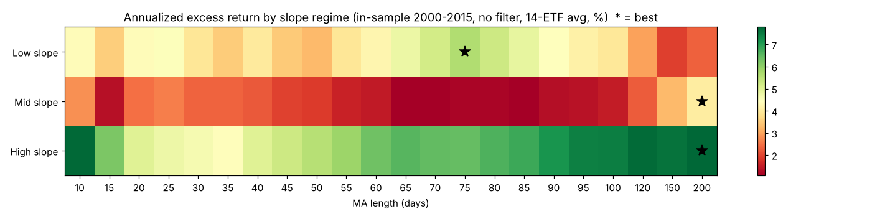
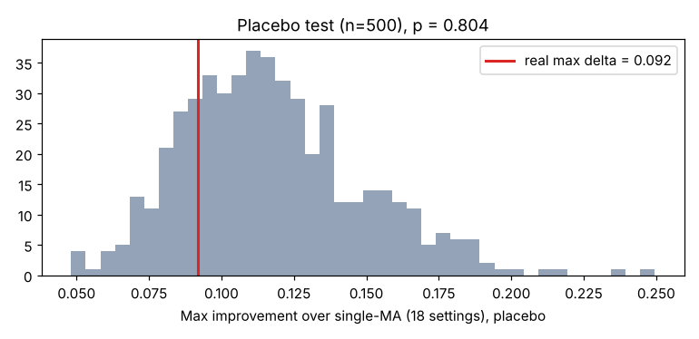
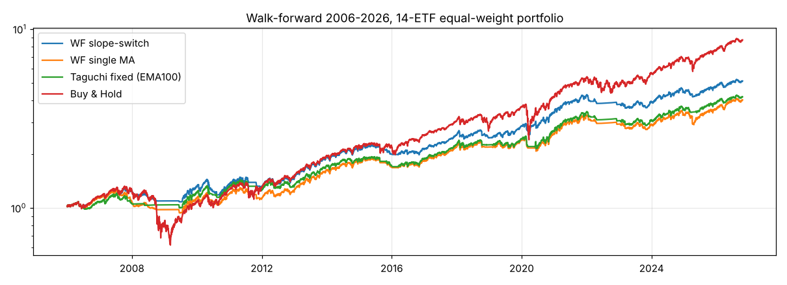

# 장기추세 기울기별 이평선 전환 규칙 — 철저 검증 리포트

**가설**: 장기추세(SPY 200일선)의 기울기 국면마다 최적 이평선이 다르다. 그렇다면 국면에 따라 이평선을 바꿔 쓰는 규칙이 하나의 이평선을 고정해 쓰는 것보다 낫다.

- 규칙: t일 종가에 SPY 200일선의 기울기 = (MA_t / MA_(t−k) − 1)×252/k 로 국면 판정 → 그 국면에 배정된 이평선의 매수/매도 신호를 따름 (매수 +1.5% 돌파, 매도 −4.0% 이탈, EMA)
- 후보 이평선 22개: [10, 15, 20, 25, 30, 35, 40, 45, 50, 55, 60, 65, 70, 75, 80, 85, 90, 95, 100, 120, 150, 200]
- 설정 18개 = 기울기 측정기간 [20, 60, 120]일 × 국면 구분 ['3분위(하/중/상)', '하락/상승(0 기준)', '하락/완만상승/가파른상승'] × 장기추세 필터(SPY>SMA225 / 없음)
- 국면 경계값은 학습구간(2000–2015) 데이터로만 결정. 평가 점수는 지난 실험과 동일: 3국면 × 14종목 = 42개 셀의 샤프 **평균 − 표준편차** (로버스트 점수)
- 데이터·비용·체결 가정은 지난 실험과 동일 (다음날 종가 체결, 편도 0.1%, 현금은 단기국채 이자)

> **결론 요약** (이 상자는 실행 결과를 보고 사람이 덧붙인 해설)
> - 학습구간에서는 국면별 전환 규칙이 단일 이평보다 점수가 높았다. 하지만 위약 검정 결과 **가짜 국면으로도 비슷한 개선이 나왔다** (전체 절차 p = 0.80). 이 개선은 "선택지가 늘어난 효과"로 설명된다.
> - 학습구간 최고 조합(10/25/120일)은 표본외 2016–2026에서 **단일 이평보다 오히려 나빴다**.
> - 시기별로 최적 조합이 제각각이었다 (80/30/120 → 10/50/100 → 200/200/200).
> - 워크포워드 전환은 단일 이평·고정 다구치보다 성과가 좋았다. 그러나 가짜 국면 위약과 비교하면 샤프 p = 0.24, CAGR p = 0.56으로 **유의하지 않았다**. 최대낙폭(MDD) 개선만 p = 0.06으로 경계선 수준이다.
> - 판단: "기울기별 최적 이평선이 존재한다"는 가설은 **통계적으로 지지되지 않음**. 단, 기울기 정보가 낙폭 방어에 약하게 기여할 가능성은 남아 있어 추가 검증 가치가 있다.

## 1. 국면은 어떤 시장이었나 (기울기 측정 60일, 3분위 기준, 학습구간)

| 국면 | 기울기 범위(연율) | 일수 비중 | SPY 연율 수익 | SPY 연율 변동성 | 이후 3개월 SPY 수익(평균) |
|---|---|---|---|---|---|
| 하위(약세) | < 4.8% | 0.333 | 0.016 | 0.277 | -0.007 |
| 중위 | 4.8% ~ 14.1% | 0.333 | 0.070 | 0.153 | 0.024 |
| 상위(강세) | > 14.1% | 0.333 | 0.092 | 0.148 | 0.022 |

## 2. 진단 — 국면별로 '어떤 이평선이 돈을 벌었나' (학습구간, 필터 없음)

각 이평선 전략을 그대로 돌린 뒤, 국면별 날짜만 모아 14종 평균 **연율 초과수익(무위험 대비)**을 계산. 블록 부트스트랩(63일 블록, 1,000회)으로 국면별 1등 이평선이 얼마나 확실한지 측정.

| 국면 | 1등 이평선 | 1등 초과수익(연율) | 꼴찌 초과수익 | 부트스트랩 1등 빈도 Top3 | 1등 이평선 90% 구간 |
|---|---|---|---|---|---|
| 하위(약세) | 75 | 0.056 | 0.019 | 75일 36%, 10일 35%, 200일 6% | 10–200일 |
| 중위 | 200 | 0.041 | 0.011 | 200일 62%, 10일 22%, 25일 6% | 10–200일 |
| 상위(강세) | 200 | 0.078 | 0.044 | 10일 48%, 200일 25%, 95일 8% | 10–200일 |

## 3. 설정 18개 × 국면별 이평선 조합 전수조사 (학습구간 2000–2015)

| 순위 | 필터 | 기울기기간 | 국면구분 | 국면별 이평(약→강) | 전환 점수 | 단일 최적 | 단일 점수 | 개선폭 Δ |
|---|---|---|---|---|---|---|---|---|
| 1 | SMA225 | 60 | 하락/완만상승/가파른상승 | 10 / 25 / 120 | 0.093 | 120 | 0.016 | 0.077 |
| 2 | 없음 | 60 | 하락/완만상승/가파른상승 | 75 / 200 / 120 | 0.082 | 200 | -0.010 | 0.092 |
| 3 | 없음 | 120 | 하락/완만상승/가파른상승 | 75 / 150 / 10 | 0.080 | 200 | -0.010 | 0.090 |
| 4 | SMA225 | 60 | 3분위(하/중/상) | 25 / 25 / 120 | 0.079 | 120 | 0.016 | 0.063 |
| 5 | 없음 | 60 | 하락/상승(0 기준) | 75 / 200 | 0.077 | 200 | -0.010 | 0.087 |
| 6 | 없음 | 60 | 3분위(하/중/상) | 75 / 200 / 120 | 0.075 | 200 | -0.010 | 0.085 |
| 7 | 없음 | 120 | 3분위(하/중/상) | 75 / 200 / 200 | 0.073 | 200 | -0.010 | 0.083 |
| 8 | 없음 | 120 | 하락/상승(0 기준) | 75 / 200 | 0.071 | 200 | -0.010 | 0.081 |
| 9 | SMA225 | 20 | 3분위(하/중/상) | 40 / 50 / 150 | 0.070 | 120 | 0.016 | 0.054 |
| 10 | 없음 | 20 | 하락/상승(0 기준) | 75 / 200 | 0.067 | 200 | -0.010 | 0.076 |
| 11 | 없음 | 20 | 하락/완만상승/가파른상승 | 75 / 200 / 200 | 0.067 | 200 | -0.010 | 0.076 |
| 12 | SMA225 | 20 | 하락/완만상승/가파른상승 | 100 / 50 / 150 | 0.066 | 120 | 0.016 | 0.050 |
| 13 | SMA225 | 120 | 3분위(하/중/상) | 10 / 30 / 150 | 0.065 | 120 | 0.016 | 0.049 |
| 14 | SMA225 | 120 | 하락/완만상승/가파른상승 | 10 / 25 / 120 | 0.062 | 120 | 0.016 | 0.046 |
| 15 | 없음 | 20 | 3분위(하/중/상) | 75 / 20 / 120 | 0.042 | 200 | -0.010 | 0.052 |
| 16 | SMA225 | 120 | 하락/상승(0 기준) | 10 / 150 | 0.027 | 120 | 0.016 | 0.010 |
| 17 | SMA225 | 20 | 하락/상승(0 기준) | 10 / 150 | 0.023 | 120 | 0.016 | 0.007 |
| 18 | SMA225 | 60 | 하락/상승(0 기준) | 10 / 120 | 0.023 | 120 | 0.016 | 0.007 |

(전수조사 평가 130,680개 조합, 1.1초)

→ 최고 설정: 필터 SMA225, 기울기 60일, 하락/완만상승/가파른상승, 국면별 이평 **10 / 25 / 120일** (로버스트 점수 0.093 vs 단일 120일 0.016)

## 4. 위약(placebo) 검정 — 개선이 '기울기 정보' 덕분인가, 단지 '선택지가 늘어서'인가

전환 규칙은 단일 이평선을 특수한 경우로 포함하므로 학습구간에서는 **항상** 같거나 더 좋게 나온다. 그래서 국면 라벨을 시간축에서 무작위로 1년 이상 밀어(국면의 길이·비율은 유지, 기울기와의 연결만 끊음) 18개 설정 전체 탐색을 500회 반복했다. 실제 Δ가 가짜 Δ보다 충분히 커야 기울기 정보가 진짜다.

| # | 필터 | 기울기기간 | 국면구분 | 실제 Δ | 위약 Δ 평균 | 위약 Δ 95% | p값 |
|---|---|---|---|---|---|---|---|
| 1 | SMA225 | 20 | 3분위(하/중/상) | 0.054 | 0.046 | 0.074 | 0.282 |
| 2 | SMA225 | 20 | 하락/상승(0 기준) | 0.007 | 0.022 | 0.046 | 0.930 |
| 3 | SMA225 | 20 | 하락/완만상승/가파른상승 | 0.050 | 0.044 | 0.072 | 0.304 |
| 4 | SMA225 | 60 | 3분위(하/중/상) | 0.063 | 0.044 | 0.072 | 0.142 |
| 5 | SMA225 | 60 | 하락/상승(0 기준) | 0.007 | 0.022 | 0.044 | 0.926 |
| 6 | SMA225 | 60 | 하락/완만상승/가파른상승 | 0.077 | 0.043 | 0.074 | 0.028 |
| 7 | SMA225 | 120 | 3분위(하/중/상) | 0.049 | 0.044 | 0.075 | 0.368 |
| 8 | SMA225 | 120 | 하락/상승(0 기준) | 0.010 | 0.022 | 0.048 | 0.830 |
| 9 | SMA225 | 120 | 하락/완만상승/가파른상승 | 0.046 | 0.044 | 0.074 | 0.408 |
| 10 | 없음 | 20 | 3분위(하/중/상) | 0.052 | 0.085 | 0.142 | 0.854 |
| 11 | 없음 | 20 | 하락/상승(0 기준) | 0.076 | 0.043 | 0.089 | 0.130 |
| 12 | 없음 | 20 | 하락/완만상승/가파른상승 | 0.076 | 0.082 | 0.146 | 0.502 |
| 13 | 없음 | 60 | 3분위(하/중/상) | 0.085 | 0.089 | 0.152 | 0.524 |
| 14 | 없음 | 60 | 하락/상승(0 기준) | 0.087 | 0.046 | 0.100 | 0.092 |
| 15 | 없음 | 60 | 하락/완만상승/가파른상승 | 0.092 | 0.087 | 0.148 | 0.370 |
| 16 | 없음 | 120 | 3분위(하/중/상) | 0.083 | 0.090 | 0.150 | 0.578 |
| 17 | 없음 | 120 | 하락/상승(0 기준) | 0.081 | 0.045 | 0.097 | 0.126 |
| 18 | 없음 | 120 | 하락/완만상승/가파른상승 | 0.090 | 0.088 | 0.144 | 0.424 |

- **전체 절차 기준(18개 중 최댓값 비교) p값 = 0.804** — 여러 설정을 시험한 것까지 감안한 공정한 p값
- 개별 p<0.05 설정 수: 1/18 (우연이라도 약 1개는 나올 수 있음)

## 5. 시기별 일관성 — 학습구간 3개 시기에서 따로 최적화하면 같은 답이 나오나

| 시기 | 국면별 최적 이평(약→강) | 단일 최적 | Δ |
|---|---|---|---|
| 2000–2005 | 80 / 30 / 120 | 15 | 0.088 |
| 2006–2010 | 10 / 50 / 100 | 100 | 0.069 |
| 2011–2015 | 200 / 200 / 200 | 200 | 0.000 |

## 6. 정확한 백테스트 — 전환 시점 매매비용까지 반영, 학습구간 vs 표본외(2016–2026)

| 학습구간 2000–2015 | 종목평균 CAGR | 종목평균 샤프 | 종목평균 MDD | 포트 CAGR | 포트 샤프 | 포트 MDD |
|---|---|---|---|---|---|---|
| 기울기 전환 규칙(최고 설정) | 0.057 | 0.378 | -0.220 | 0.059 | 0.464 | -0.154 |
| 단일 이평 120일(같은 설정의 단일 최적) | 0.052 | 0.346 | -0.250 | 0.055 | 0.421 | -0.170 |
| 지난 다구치 최적 EMA100/+1.5/−4/SMA225 | 0.050 | 0.329 | -0.242 | 0.052 | 0.400 | -0.174 |
| 매수 후 보유 | 0.053 | 0.283 | -0.596 | 0.062 | 0.319 | -0.531 |

| 표본외 2016–2026 | 종목평균 CAGR | 종목평균 샤프 | 종목평균 MDD | 포트 CAGR | 포트 샤프 | 포트 MDD |
|---|---|---|---|---|---|---|
| 기울기 전환 규칙(최고 설정) | 0.074 | 0.413 | -0.242 | 0.079 | 0.576 | -0.159 |
| 단일 이평 120일(같은 설정의 단일 최적) | 0.079 | 0.442 | -0.254 | 0.083 | 0.614 | -0.172 |
| 지난 다구치 최적 EMA100/+1.5/−4/SMA225 | 0.082 | 0.461 | -0.252 | 0.086 | 0.641 | -0.165 |
| 매수 후 보유 | 0.129 | 0.581 | -0.386 | 0.136 | 0.693 | -0.367 |

## 7. 워크포워드 — 매년 초, 그 전까지의 데이터만으로 '설정 + 국면별 이평'을 다시 골라 1년 운용

비교 대상도 같은 방식으로 매년 다시 고른 **단일 이평선**(필터 유무 포함)이다. 둘 다 미래 정보 없음.

| 연도 | 선택 설정 | 국면별 이평 | 단일 이평 |
|---|---|---|---|
| 2006 | 필터없음/20일/Z3 | 80 / 20 / 200 | 10일(필터없음) |
| 2007 | 필터없음/120일/Q3 | 10 / 150 / 200 | 30일(SMA225) |
| 2008 | 필터없음/20일/Q3 | 80 / 20 / 200 | 200일(필터없음) |
| 2009 | SMA225/60일/Q3 | 10 / 50 / 200 | 50일(SMA225) |
| 2010 | SMA225/60일/Q3 | 10 / 45 / 200 | 30일(SMA225) |
| 2011 | SMA225/60일/Z3 | 10 / 35 / 120 | 25일(SMA225) |
| 2012 | 필터없음/120일/Q3 | 75 / 150 / 10 | 120일(필터없음) |
| 2013 | 필터없음/20일/Z3 | 80 / 10 / 200 | 200일(필터없음) |
| 2014 | 필터없음/60일/Q3 | 75 / 10 / 200 | 200일(필터없음) |
| 2015 | SMA225/60일/Z3 | 10 / 25 / 150 | 120일(SMA225) |
| 2016 | SMA225/60일/Z3 | 10 / 25 / 120 | 45일(SMA225) |
| 2017 | SMA225/60일/Q3 | 100 / 20 / 120 | 120일(SMA225) |
| 2018 | 필터없음/120일/Z3 | 75 / 200 / 10 | 120일(SMA225) |
| 2019 | 필터없음/120일/Z3 | 75 / 200 / 10 | 120일(SMA225) |
| 2020 | 필터없음/120일/Z3 | 75 / 200 / 10 | 120일(SMA225) |
| 2021 | 필터없음/120일/Z3 | 75 / 200 / 10 | 120일(SMA225) |
| 2022 | SMA225/20일/Z3 | 80 / 50 / 200 | 120일(SMA225) |
| 2023 | SMA225/20일/Z3 | 80 / 50 / 200 | 120일(SMA225) |
| 2024 | 필터없음/120일/Q3 | 75 / 10 / 10 | 10일(필터없음) |
| 2025 | 필터없음/60일/Z3 | 75 / 200 / 120 | 10일(필터없음) |
| 2026 | SMA225/20일/Z3 | 10 / 50 / 150 | 10일(필터없음) |

→ 해마다 고른 조합이 크게 흔들리면, 기울기별 최적 이평이 '안정된 법칙'이 아니라는 신호다.

| 워크포워드 2006–2026 | 종목평균 CAGR | 종목평균 샤프 | 종목평균 MDD | 포트 CAGR | 포트 샤프 | 포트 MDD |
|---|---|---|---|---|---|---|
| 워크포워드 기울기 전환 | 0.078 | 0.491 | -0.262 | 0.082 | 0.628 | -0.182 |
| 워크포워드 단일 이평 | 0.065 | 0.415 | -0.312 | 0.069 | 0.528 | -0.261 |
| 지난 다구치 최적(고정) | 0.068 | 0.439 | -0.260 | 0.071 | 0.559 | -0.174 |
| 매수 후 보유 | 0.103 | 0.498 | -0.558 | 0.110 | 0.557 | -0.531 |

| 그중 2016–2026 | 종목평균 CAGR | 종목평균 샤프 | 종목평균 MDD | 포트 CAGR | 포트 샤프 | 포트 MDD |
|---|---|---|---|---|---|---|
| 워크포워드 기울기 전환 | 0.087 | 0.486 | -0.253 | 0.091 | 0.680 | -0.160 |
| 워크포워드 단일 이평 | 0.079 | 0.437 | -0.268 | 0.084 | 0.602 | -0.172 |
| 지난 다구치 최적(고정) | 0.082 | 0.461 | -0.252 | 0.086 | 0.641 | -0.165 |
| 매수 후 보유 | 0.129 | 0.581 | -0.386 | 0.136 | 0.693 | -0.367 |

- 연도별로 기울기 전환이 단일 이평을 이긴 비율: **43%** (21년), 연평균 수익 차이 +1.28% (t = 1.26, |t|>2 이어야 통계적으로 의미)

### 워크포워드 위약 검정 (50회) — 워크포워드 성과가 '기울기 정보' 덕분인가

국면 라벨만 시간축에서 무작위로 밀어(기울기와 무관한 가짜 국면) 위의 워크포워드 절차를 통째로 반복했다. 가짜 국면으로도 비슷한 성과가 나오면, 개선은 기울기 덕분이 아니라 '여러 이평선을 섞어 쓰는 효과(분산)' 때문이다.

| 2006–2026 포트폴리오 | 실제(기울기 국면) | 위약 평균 | 위약 95% | p값(위약 ≥ 실제) |
|---|---|---|---|---|
| 포트 샤프 | 0.628 | 0.589 | 0.679 | 0.240 |
| 포트 CAGR | 0.082 | 0.084 | 0.099 | 0.560 |
| 포트 MDD | -0.182 | -0.243 | -0.183 | 0.060 |

## 부록. 고속 평가기 정합성

- 단일 이평 120일 로버스트 점수: 고속 0.0162 vs 정확 0.0162
- 전환 규칙 로버스트 점수: 고속 0.0928 vs 정확(전환 비용 포함) 0.0918

