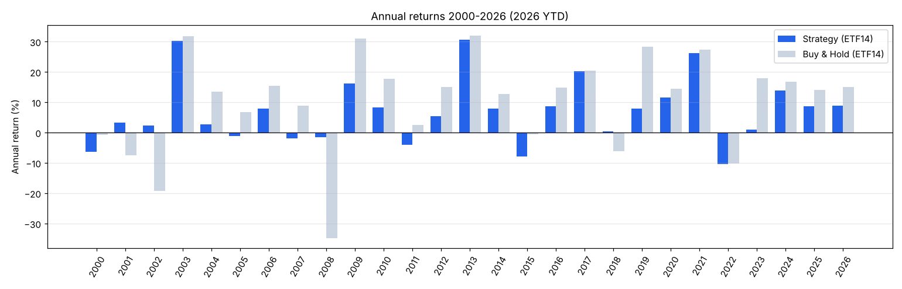

# 연도별 수익률

- 전략: EMA100 +1.5% 돌파 매수 / −4% 이탈 매도, SPY>SMA225 장기추세 필터. 다음날 종가 체결, 편도 0.1% 비용, 현금은 단기국채 이자
- ETF14·대형주50은 동일가중 포트폴리오. ×1.6 = 보유 시 1.6배 (차입금리 = 국채 + 1.5%)
- 2026년은 2026-10-20까지 (연중)

| 연도 | 전략 ETF14 | 보유 ETF14 | 전략 ETF14 ×1.6 | 전략 SPY만 | 보유 SPY | 전략 대형주50 | 보유 대형주50 | ETF14 평균 투자비중 |
|---|---|---|---|---|---|---|---|---|
| 2000 | -6.3% | -0.8% | -13.9% | -12.6% | -9.7% | -11.5% | -5.1% | 45% |
| 2001 | +3.3% | -7.4% | +3.3% | +3.3% | -11.8% | +3.3% | -2.9% | 0% |
| 2002 | +2.4% | -19.2% | +2.9% | +1.1% | -21.6% | +1.1% | -22.7% | 4% |
| 2003 | +30.2% | +31.8% | +49.8% | +27.6% | +28.2% | +25.2% | +40.9% | 71% |
| 2004 | +2.8% | +13.5% | +2.4% | +5.4% | +10.7% | +4.4% | +10.9% | 80% |
| 2005 | -1.1% | +6.9% | -4.7% | -2.1% | +4.8% | -2.0% | +3.0% | 80% |
| 2006 | +7.9% | +15.5% | +8.7% | +9.7% | +15.8% | +8.1% | +15.7% | 82% |
| 2007 | -2.0% | +8.9% | -6.8% | -8.9% | +5.1% | -0.1% | +3.2% | 79% |
| 2008 | -1.6% | -34.8% | -3.3% | -1.4% | -36.8% | -1.2% | -36.3% | 1% |
| 2009 | +16.2% | +30.9% | +25.8% | +16.3% | +26.4% | +13.7% | +50.6% | 49% |
| 2010 | +8.3% | +17.7% | +11.8% | +6.9% | +15.1% | +2.0% | +14.1% | 73% |
| 2011 | -4.0% | +2.5% | -7.4% | -4.0% | +1.9% | -4.0% | -1.2% | 60% |
| 2012 | +5.4% | +15.1% | +7.3% | +3.4% | +16.0% | +7.8% | +19.7% | 86% |
| 2013 | +30.7% | +32.0% | +51.2% | +32.3% | +32.3% | +42.5% | +49.0% | 99% |
| 2014 | +7.8% | +12.6% | +11.3% | +7.3% | +13.5% | +7.9% | +17.6% | 93% |
| 2015 | -8.0% | -0.6% | -13.4% | -9.6% | +1.3% | -10.2% | -3.9% | 67% |
| 2016 | +8.7% | +14.8% | +12.8% | +7.3% | +12.0% | +8.5% | +20.5% | 76% |
| 2017 | +20.2% | +20.4% | +32.0% | +21.7% | +21.7% | +13.7% | +19.0% | 96% |
| 2018 | +0.4% | -6.1% | -1.7% | +5.2% | -4.6% | -1.6% | -7.8% | 70% |
| 2019 | +7.9% | +28.4% | +10.2% | +12.9% | +31.2% | +10.0% | +39.7% | 84% |
| 2020 | +11.6% | +14.5% | +16.9% | +14.6% | +18.4% | +2.6% | +11.9% | 71% |
| 2021 | +26.3% | +27.4% | +42.8% | +28.7% | +28.7% | +23.5% | +30.0% | 98% |
| 2022 | -10.4% | -10.1% | -17.2% | -13.4% | -18.2% | -7.6% | -9.2% | 13% |
| 2023 | +0.9% | +17.9% | -2.4% | +5.5% | +26.2% | +7.0% | +22.5% | 68% |
| 2024 | +13.9% | +16.7% | +17.9% | +24.9% | +24.9% | +21.2% | +22.1% | 96% |
| 2025 | +8.7% | +14.1% | +10.4% | +11.8% | +17.7% | +15.2% | +28.8% | 76% |
| 2026 | +8.8% | +15.0% | +11.6% | +6.0% | +13.7% | +13.7% | +23.1% | 87% |

## 요약

| 전략 | 연평균(CAGR) | 플러스인 해 | 최악의 해 | 최고의 해 | 전략이 보유를 이긴 해 |
|---|---|---|---|---|---|
| 전략 ETF14 | +6.6% | 20/27 | -10.4% | +30.7% | 4/27 |
| 보유 ETF14 | +9.1% | 20/27 | -34.8% | +32.0% |  |
| 전략 ETF14 ×1.6 | +8.3% | 18/27 | -17.2% | +51.2% | 10/27 |
| 전략 SPY만 | +6.8% | 20/27 | -13.4% | +32.3% | 5/27 |
| 보유 SPY | +8.3% | 21/27 | -36.8% | +32.3% |  |
| 전략 대형주50 | +6.6% | 19/27 | -11.5% | +42.5% | 5/27 |
| 보유 대형주50 | +11.2% | 19/27 | -36.3% | +50.6% |  |

